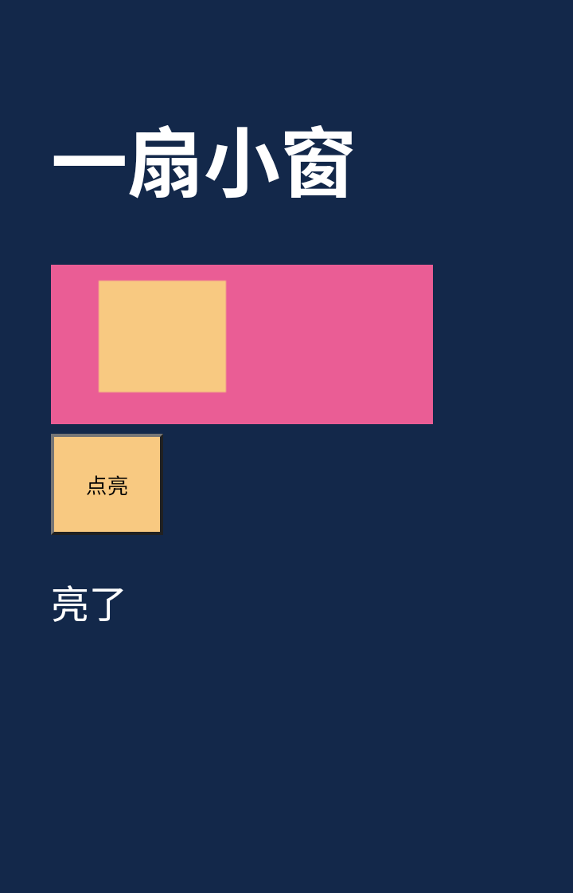

# 小作品第一批与梦境恢复 · v0.42.95+339

状态：CI PASSED / APK READY / TRUE DEVICE PENDING。基线 f424213e3eddb862245d490f11dd9cda60fbf6fc（+338），分支 agent/v04295-creative-workspace。

## 授权与产品范围

2026-10-11 17:03 用户授权开始第一批及梦境运行修查。工作模型只新增名称和思考力度，沿用DeepSeek连接，默认最高支持档。保留聊天设置和正文通道。今日消耗显示在DeepSeek余额右侧、同色、简写“今日：-￥5.74”；口径为本App已记录DeepSeek用量的费用估算，不是账号日账单，缺价格/用量不装成零。

只有发送时已开深度思考的明确委托，才允许启动制作或实质修改；开关打开不追溯执行旧委托，关闭不取消已授权任务。普通聊天可以讨论、查看、反馈和停止，不因关键词误开工。本批不接自主创作，也不增加普通聊天每轮Agent。第二批再设计日常兴趣/线索、空闲构思、梦境自我理解的联系，梦境不强制产出创意或做梦事实。

作品采用本地HTML/CSS/JS，题材开放。玩家体验为：委托→后台安静制作→真实检查→作品卡片→App内作品页/聊天→退出继续→存档导入后继续。左侧“作品集”承接成品和明确委托进度，导出/删除/修改放次级操作。不把点击/未打开当喜欢/拒绝，不自动催看。

## 实现约束

- 使用独立作品记录/持久任务与版本，按步骤保存，正常聊天及备份恢复优先。停止或恢复后晚到结果不得写回。
- 首先验证后台网页执行/截图/交互，不抢主屏、不弹Activity、不抢输入焦点；失败保持待检查，不发布假成品。系统暂停/强停不承诺永续。
- 作品通信限当前作品/会话有效动作，不暴露Key、全部记忆或任意原生工具。模型只在需要参与时调用，普通按钮/动画本地执行。猜拳验证必须先提交她的选择再揭晓，恢复不重选。
- App内播放器优先，聊天内嵌后续按实际稳定性决定；保护Live2D层、输入法和返回导航。正在玩的旧版本不能被新稿直接覆盖。
- 备份含源码、必要资源、草稿、游玩状态和未揭晓选择；事务校验/恢复，不自动重新开工/分享。限制版本与缓存，素材去重。
- 每次真实DeepSeek请求费用分别计，重复usage去重；日累计持久且跨前后台安全，不依赖最近120条诊断环。模型价格必须有依据，不按flash/pro名称猜价。

## 梦境已确认机制与待解决点

当前梦境已有日间空档补做及每日最多一次成功；失败不推进游标。抢占和网络错误共用30/60/120/240分钟退避；完整结果仅内存保存；提交检查消息快照、来源指纹及工作围栏。统一interrupted_or_preempted不足以确定根因。优先细分原因、区分让路与接口退避、核实队列机会；不直接放松恢复/来源保护。完整候选持久续做属于需单独验证的更大改动，不能将旧结果不经核对提交。

## 验证要求

1. 普通模式拒绝委托工具；深度讨论不自动开工；明确委托可建立唯一任务；停用/恢复围栏有效。
2. 原生后台加载实际DOM/CSS/Canvas、非空截图、JS错误、按钮状态改变；切App/锁屏不抢屏；渲染异常可结束。
3. 有真实文件输出、检查失败可修复、完成只能在检查之后；模型/网络失败保存状态。
4. 真实双人回合、重复请求去重、离页重进保留同局；游玩不要求深度思考。
5. SQLite/文件存档往返、缺项损坏拒绝、老包兼容、备份/导入时晚到任务不能回写。
6. 日统计跨日/重启/重复usage/缺usage/自定义未知价格；梦境抢占恢复、失败退避、无变化完成与来源失效。
7. 现行源码门、全量Flutter、专项、Android原生与同签名APK通过；真实设备耗电/锁屏、语义创作质量仍另标待验。

## 实施记录

- 2026-10-11：完成轻量接班及授权范围记录。检出代码/测试/构建配置，不下载约190MiB桌宠帧包；未读取用户私密附件。开始原生预览接入验证。

- 已实现：DeepSeek 工作模型（名称自由填写，默认 deepseek-flash / max，沿用 Key/地址）；模型配置导出向后兼容；余额右侧同色今日费用估算。
- 委托工具只在该聊天任务保存的 deepThinking=true 时可用，执行器和存储再次校验本轮原话；关闭开关不终止已授权任务。普通聊天可明确暂停已有制作，不能开始/恢复/修改。停止、删除、重复请求和恢复均有原子比较保护。
- 前台与现有后台运行时共同消费同一个 SQLite 队列，独立租约避免重复制作。前台也能处理队列，不依赖悬浮权限才能开工；持续离开 App 后依赖现有后台陪伴服务与 Android 调度，系统强停后保留检查点，下次启动继续。本批没有新增占用主屏的页面、录屏或悬浮权限。
- 原生 private VirtualDisplay + Presentation + WebView 实际运行页面、执行选择器点击/文本检查、捕获脚本错误和渲染帧。失败最多三轮修复，不把模型自称成功当成品；失去执行环境时保留草稿。后台预览与前台播放器使用同一隔离规则，禁止网络、文件读取、嵌套页面和任意原生工具。
- 作品集和聊天作品卡已接入；作品页可展开同一 ChatController 的聊天面板。源码按 SHA-256 去重，内联 HTML/CSS/JS/数据资源每版上限 800 KB，保留最近三版及正在游玩的旧版，未引用源码回收。作品封面来自真实渲染截图。
- 互动桥接包含轻量进度、有限选项选择、封存后揭晓和结果报告。API Key/完整记忆/未揭晓选择不下发网页；重复 choose 不重选，重复 reveal 保持第一次玩家选择，普通按钮本地执行。每局最多 200 个持久回合，每分钟最多 5 次模型决策；开始新一局由玩家明确操作。存档包括隐蔽选择，旧播放器在恢复后失去写入资格。
- `.aibackup` 直接携带独立 settings 记录中的目录/源码/草稿/版本/游玩状态，不把桌宠或图库资源重新塞进包；导入前校验作品内容哈希和结构，进行中的任务转为 paused，打开作品不会自动继续制作。HTML 导出是源文件，宿主互动仍需 App。
- 今日费用按每次 HTTP 请求生成独立 ID；初始未知，收到实际 usage 后按定价估算，重复 usage 不重复累计，重试各记一次。缺失用量/未知模型或代理价格显示“今日：—”，点击可看已知部分。保留 8 天记录，按手机本地日期；不读取账户日账单。定价源：https://api-docs.deepseek.com/zh-cn/quick_start/pricing/（2026-10-11）；工作日高峰价不识别中国节假日优惠，详情明确可能高估，不按 Flash/Pro 强弱猜价。
- 梦境保留每日最多一次成功、空闲条件、来源指纹和恢复围栏；聊天/活动抢占采用下次空闲可重试的短退避，不计入接口失败次数；进程消失留下的 preparing 不再当网络失败等待半小时。提交前消息/证据变化仍不写入旧见解，诊断区分活动抢占和证据变化；真正调用失败继续指数退避。没有添加固定创作欲望、节日必做或虚构梦境经历。

### 验证进度与失败路线

- 原生独立探针 38127523232 / 38128603894 通过 Android 15：后台实际画面、按钮、错误捕获和息屏；后来新增真实桥接对象检查及 Android 8 覆盖。
- 第一轮 Dart 检查 38128604063 无编译错误，但新流程把既有 warnings 设为阻断；已与项目现有 `--no-fatal-infos --no-fatal-warnings` 规则一致，不忽略编译错误。
- 38128910014 / 38128909994 发现存档目录列表具体类型导致替换行失败；改为复制独立列表再规范化，保留真实数据库往返测试。
- 38129232913 新增模型模拟测试的中文 HTTP fixture 使用了默认 Latin-1；已明确 UTF-8。此前的生产导入修复与梦境测试均通过。
- Android 8 旧 WebView 自动请求 favicon 被 CSP 拦截误算作品失败；使用本地 data 图标解决，没有放宽网络隔离。原生互动用例又发现 Map 回复需要先 JSONObject.wrap 再编码，已修复并保留同一测试。
- 源码 557007d：54 项作品/梦境/模型设置测试、545 项稳定性专项通过（38129512216 / 38129512253）；后续补充恢复会话围栏、前台恢复入口和待处理状态二次检查，最终证据待全量 CI。
- 本地 Flutter 初始化曾被自动审批拒绝（启动链尝试访问云元数据），未继续该路径；编译/运行全部走仓库现有 GitHub CI。本地源码门因稀疏检出未物化第三方 notices 停止，不把它记作代码回归，也不以该结果代替 CI。

- 最终功能提交5285186：56项作品/梦境/模型设置测试、546项稳定性专项通过；38130285748的34项Android15和5项Android8测试全部成功，但截图归档读到已由UTP清理的App外部目录，构建门因此失败。已按现有银河/提醒截图做法，在测试结束前复制并逐字节核对到/data/local/tmp，再归档真实PNG；没有放松测试门。仅测试留图修正后的源码为eb4dbad，该构建的原生测试与截图归档均通过，但打包在旧版本白名单停止。

### 实际后台渲染帧

来自Android15的真实private VirtualDisplay，720×1120，19,618字节；按钮点击后Canvas出现黄色块，文字从“未点亮”变成“亮了”。这是自动验证通道的测试页，正式作品按用户委托由工作模型生成。已目视核对中文、画布、按钮与结果文字；保留帧与测试取得的PNG逐字节相同。

### 完整构建回归门适配

38130800732在第18项源码门发现旧正则白名单没有+339；已逐一扩展10处版本门，保留全部断言。另外复核数据库相对+338仅增加导入前作品规范化入口后，更新该文件的已审查哈希。快速索引超100 KB时，把+323/+324原索引全文转存到同一总账文末，冻结归档字节未变，未放宽100 KB上限。本地142项可执行源码门通过；8项依赖未物化资源或本地缺失的Kotlin编译器，由完整CI执行。远端370b9e9与本地e849199同树8fe40a1；完整构建38131888279已成功，最终证据如下。

## 真机首轮体验入口

1. 在聊天模型下方保存工作模型，沿用当前 DeepSeek 连接；默认 deepseek-flash / max。
2. 开启深度思考，明确说“给我做一个我们能一起玩的猜拳小游戏”。在作品卡或左侧作品集查看进度，切走 App 后由已启用的后台陪伴服务继续。
3. 打开成品，验证先封存她的选择再揭晓；退出重进保留同局，作品页聊天使用原聊天控制器。生成内容的实际质量仍需真实模型与用户设备验证。
4. 关闭深度思考后，已授权任务继续；普通聊天讨论新点子不应开始新作品。明确说“停止制作这个作品”可暂停。
5. 导出并恢复 .aibackup 后检查作品与同局进度，导入的进行中制作保持暂停，用户明确恢复才继续。恢复测试应使用常规完整备份流程。
6. 点击今日费用看估算口径；跨日/断流无usage/自定义未知价不承诺与DeepSeek账户账单完全一致。梦境在聊天打断后应标记活动抢占，下次满足空闲条件重试，不直接复用失效候选。

## 最终交付证据

- 最终构建源码370b9e99538dc516ab66dc6268d6bcf7aefbc40f，本地e849199同树8fe40a18a9e41b9a60e97c4b91e01774510558de。完整CI [38131888279](https://github.com/catkiss62/ai-companion-build/actions/runs/38131888279)成功：150项源码、1497项全量Flutter、Kotlin回归、34项Android15、5项Android8、原有资源与签名检查通过。静态分析无编译error，保留既有info/warnings。
- 最新稳定性 [38131888224](https://github.com/catkiss62/ai-companion-build/actions/runs/38131888224)成功，546项通过。构建耗时约24分钟，主要为原生模拟器、原有资源生成、Kotlin/Flutter测试与编译。
- [未发布同签名APK下载页](https://github.com/catkiss62/ai-companion-build/releases/tag/untagged-0765977fd54d004bef58)：`AI-Companion-v0.42.95-339-Creative-Workspace-APK.apk`，736,913,481字节，Draft409574305/资产630487874；SHA文件和成功CI Monitor均已上传。没有合并main或正式发布。
- APK SHA-256：`3385397495d67ad303bbc7277849275c3acd826554466bc808d5d893720a25b8`，构建输出与GitHub上传资产digest一致。
- 实际APK签名SHA-256：`30:5E:B3:D8:09:83:B9:63:C6:48:18:DD:F1:AD:56:1F:27:9D:E6:D4:7B:3E:D2:C7:81:AD:A4:48:C7:C2:51:48`，保持原测试签名。
- 模型回归使用受控模拟响应，原生WebView/DOM/Canvas/PNG真实运行。实际DeepSeek语义创作品质、用户手机长期后台/耗电和长期梦境运行没有冒充真机验收；自主创作仍是第二批。
